# Data Structure visuals

## Python Data Structures

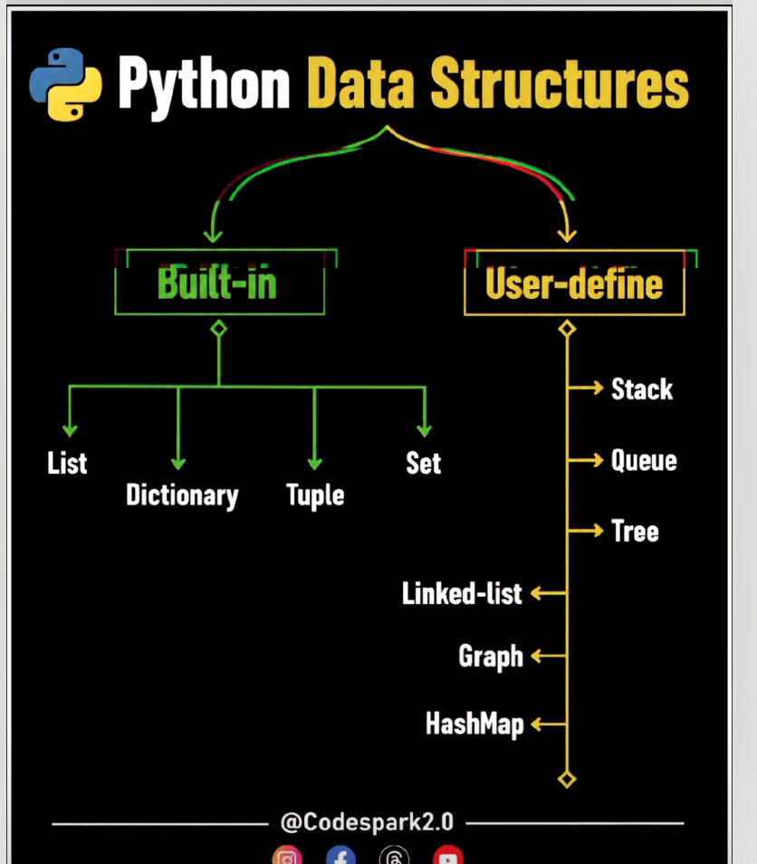

Pictures below match the 13 skeletons in [`templates.py`](templates.py). Each one is the move to see before you write code.

## 1. Hash map / set

A coat check. The ticket (key) opens one drawer. A set is the guest list: the name is on it, or it is not.

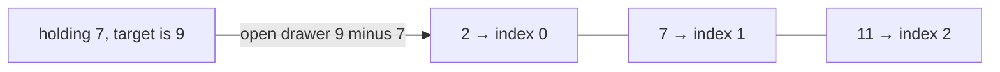

Lookup, then store. Record `2` only after you check, so a number is not paired with itself.

## 2. Two pointers

Two fingers on one line. Opposite ends walk inward. Same direction: fast reads, slow only writes what stays.

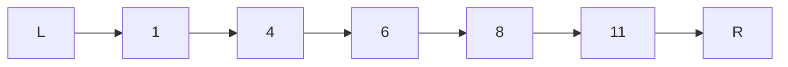

Too small: step `L` right. Too big: step `R` left. They stop when they meet.

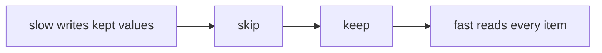

## 3. Stack

A stack of plates. The last one you set down is the first one you lift.

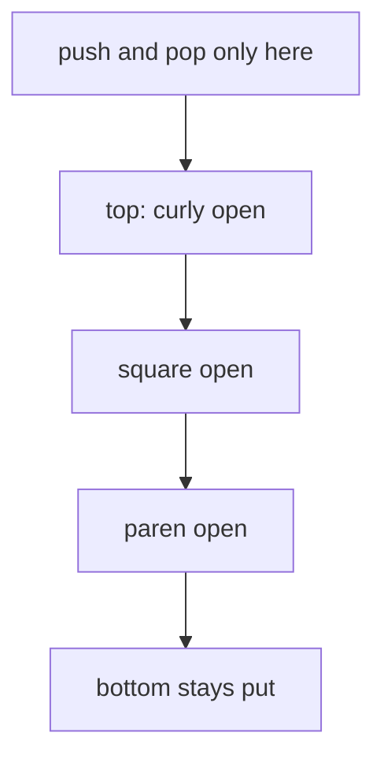

A closer must match the top plate. Pop it. If the top is the wrong opener, or the stack is empty at the end, the string is invalid.

Monotonic version: indices wait on the stack until a greater value on the right resolves them.

## 4. Queue / deque

A deli line. First person in is first person served. A deque has a door at both ends.

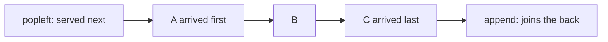

Mark a node seen when it joins the line, not when it is served. `deque.popleft()` is the pop. `list.pop(0)` walks the whole line.

## 5. Linked list

A scavenger hunt. Each clue only knows the next clue. Reverse the chain by having each person let go and grab the one behind them.

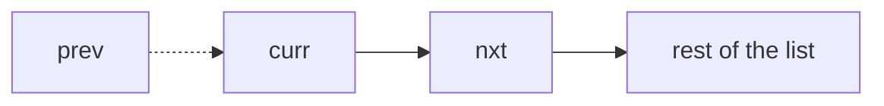

Save `nxt`, point `curr` back at `prev`, then slide all three forward. `prev` ends on the new head.

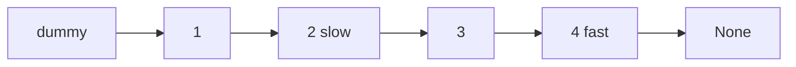

Dummy sits in front so the real head is not a special case. Fast takes two steps, slow takes one: slow is at the middle when fast runs out. If they meet, the list has a cycle.

## 6. Binary tree DFS / BFS

A family tree. DFS finishes one whole branch before the other. BFS finishes one generation before going deeper.

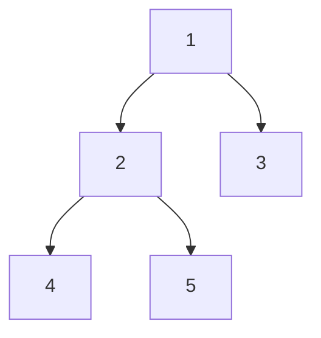

| Walk | Order you see | Tool |
| --- | --- | --- |
| DFS, go deep | 1, then all of 2, then 3 | recursion or a stack |
| BFS, one level | 1 · then 2, 3 · then 4, 5 | queue, freeze `len(q)` |

Move the visit line to change DFS order: before both children (pre), between them (in), or after them (post).

## 7. Graph

A subway map. Nodes are stations, edges are tracks. BFS asks for the fewest stops. DFS wanders one track as far as it goes.

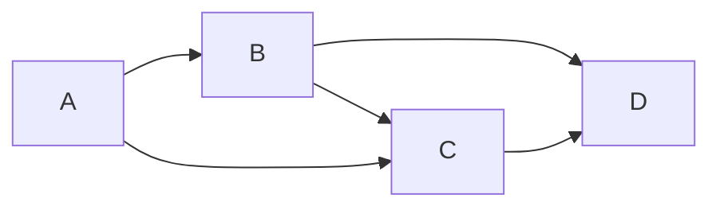

Keep a visited set or you ride the same loop forever.

Prerequisites are one-way tracks. Start with whatever nothing is blocking (indegree 0). Finishing a course unblocks the next. If some courses never start, there is a cycle.

## 8. Binary search

A dictionary. Open the middle. If your word is later, throw away the left half and repeat.

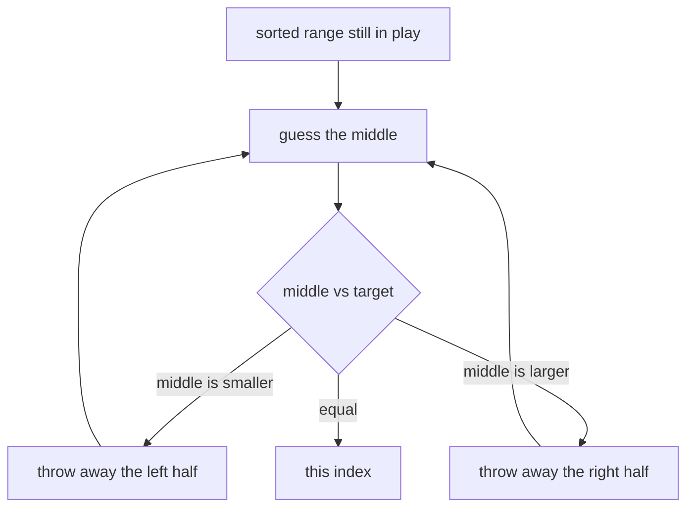

Exact match: `l = mid + 1` or `r = mid - 1`, and stop when `l` passes `r`.

Search on the answer: the predicate is False, then True. First True keeps the left side (`hi = mid`). Still False keeps the right (`lo = mid + 1`).

## 9. Sliding window

A tour bus driving along a row of people. The right end picks people up. When the bus breaks the rule, the left end lets people off until it fits. Each person boards once and steps off once.

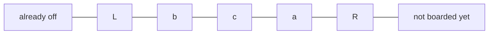

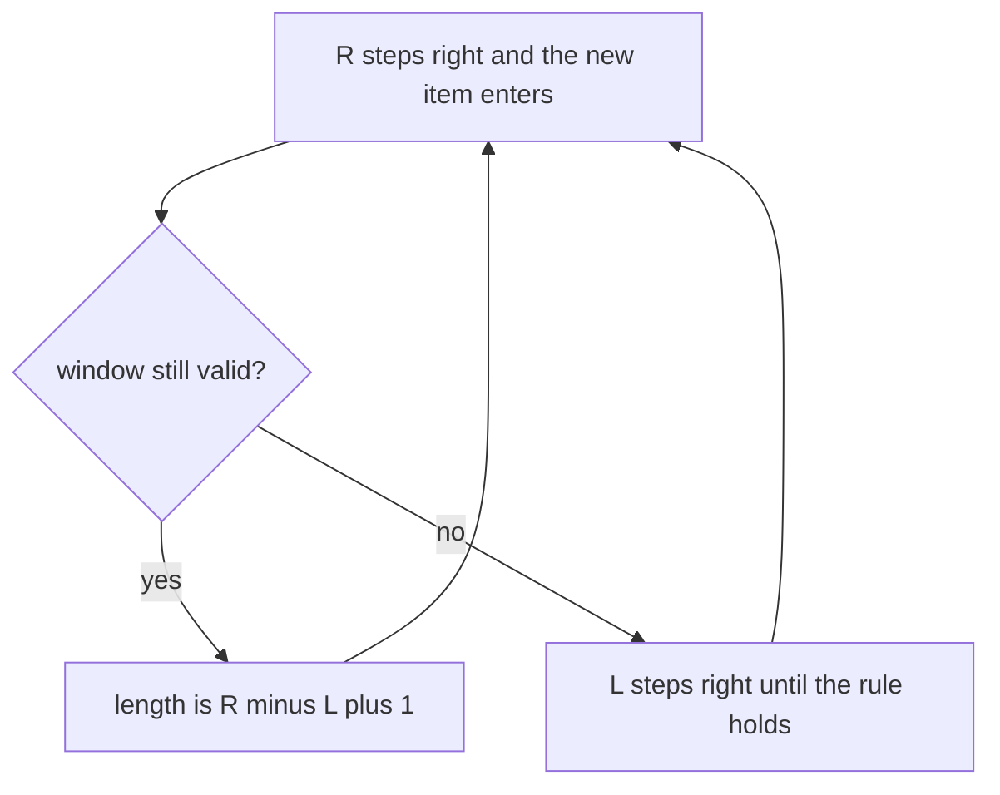

## 10. Heap

An emergency room. The most urgent patient is always next, and a new arrival can jump the line. In `heapq` the smallest value sits on top.

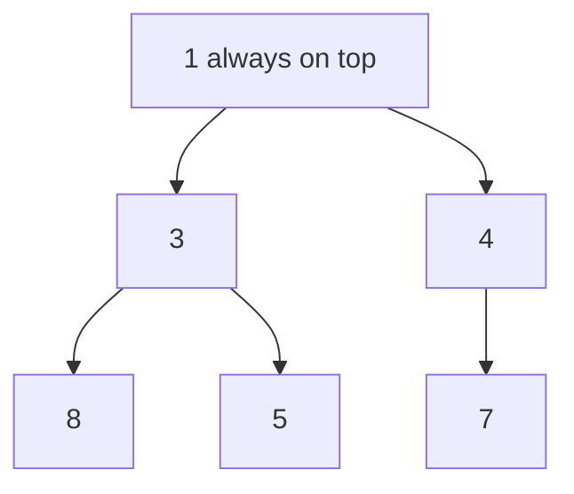

Parent is ≤ both children. Push bubbles a new value up. Pop takes the top, moves the last leaf to the top, and lets it sink.

Top k largest: keep a min-heap of size k. The smallest of those k sits on top. A new number bigger than that top replaces it. Anything smaller cannot make the top k.

Max-heap: store the negated value, so the smallest stored number is the true maximum.

## 11. Backtracking

Trying on outfits. Pick a shirt, then pants. If they clash, put the pants back and try the next pair. If nothing works, put the shirt back too.

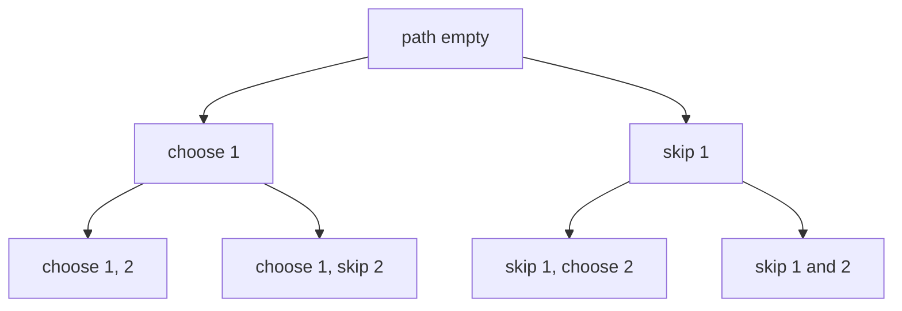

Choose, explore, undo. Copy `path` when a branch finishes, because the same list is reused. On a grid, mark the cell, try four directions, then put the cell back.

Stop a branch as soon as the partial path cannot succeed.

## 12. 1-D DP

Climbing stairs. Ways to reach step 4 are ways to reach step 3 plus ways to reach step 2. Write those answers down so you never recount from the ground.

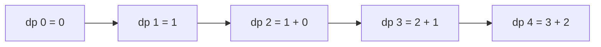

Name `dp[i]`, write the base cases, then fill in an order where `i - 1` and `i - 2` already exist. If a cell only needs the last one or two answers, two variables replace the array.

## 13. Trie

Phone contacts. Typing "Sa" walks S, then a, and the names that continue from there share that path. You do not reread every name.

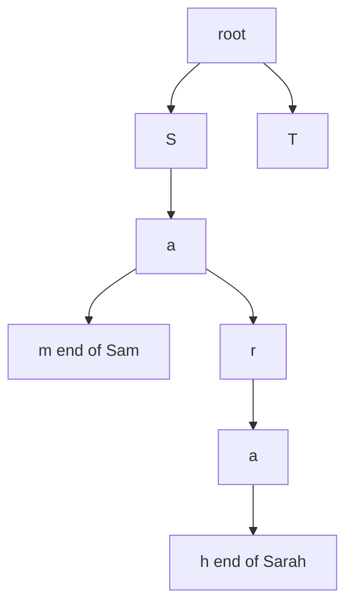

One edge per letter. A node is a whole word only when the end flag is set, so "Sa" can be a prefix of Sarah without being a stored word. Insert, search, and prefix checks walk one letter at a time.

## Time complexity summary

| # | Pattern | What you pay |
| --- | --- | --- |
| 1 | Hash map / set | O(1) average lookup, O(n) space |
| 2 | Two pointers | O(n) after the array is sorted |
| 3 | Stack | O(n) |
| 4 | Queue / deque | O(1) append and popleft |
| 5 | Linked list | O(n) time, O(1) extra for reverse |
| 6 | Binary tree DFS / BFS | O(n) |
| 7 | Graph | O(V + E) |
| 8 | Binary search | O(log n) |
| 9 | Sliding window | O(n), each index enters and leaves once |
| 10 | Heap | O(log k) per push when the heap holds k |
| 11 | Backtracking | Exponential; prune as soon as a branch is dead |
| 12 | 1-D DP | O(n), or O(n · W) when each state tries a weight |
| 13 | Trie | O(L) per word, L = length |

| Structure | Access | Search | Insert | Delete |
| --- | --- | --- | --- | --- |
| Array / list | O(1) | O(n) | O(n) in the middle, O(1) amortized at the end | O(n) |
| Hash map / set | — | O(1) avg | O(1) avg | O(1) avg |
| Stack / queue | O(1) at the ends | — | O(1) | O(1) |
| Heap | O(1) to peek the min | O(n) | O(log n) | O(log n) |
| BST, balanced | — | O(log n) | O(log n) | O(log n) |
| Trie | — | O(L) | O(L) | O(L) |
